<!--
  Karthick E | Profile README
  Custom animated SVG artwork is stored in this repository.
-->

  
  
  

---

## About

BCA graduate focused on building practical software solutions and strengthening backend engineering skills. Interested in backend development, REST API integrations, databases, and AI-powered workflows.

- 🎓 **Education:** Bachelor of Computer Applications (BCA)
- ⚙️ **Primary focus:** NestJS, TypeScript, REST APIs, and PostgreSQL
- 🧠 **Exploring:** MCP, AI agents, function calling, and n8n automation
- 🤝 **Open to:** Collaboration, learning opportunities, and entry-level software development roles

## Technology Stack

| Category | Technologies |
|---|---|
| Languages | JavaScript, TypeScript, SQL |
| Frontend | React.js, HTML5, CSS3, Bootstrap |
| Backend | Node.js, Express.js, NestJS |
| Databases | PostgreSQL, MySQL |
| APIs & Security | REST APIs, CRUD, Postman, JWT, OAuth 2.0 |
| AI & Automation | Gemini API, Groq API, Function Calling, MCP concepts, n8n |
| Tools | Git, GitHub, VS Code, Docker, Docker Compose |

## Featured Projects

### 01 — Zoho CRM ↔ Xero Integration

Backend integration work focused on connecting Zoho CRM and Xero through API-based workflows.

- Worked on Contacts and Leads operations: create, retrieve, list, and update.
- Explored OAuth 2.0 authorization and access/refresh token handling.
- Organized integration logic using NestJS modules and controllers.

**Technologies:** NestJS · TypeScript · PostgreSQL · REST APIs · OAuth 2.0

### 02 — Inventory Management System

A backend application designed to manage inventory operations and user access.

- Organized Users, Roles, Products, Categories, Suppliers, Stock, and Stock Movements modules.
- Structured role-based access for Admin, Manager, and Staff.
- Containerized the API and PostgreSQL database with Docker Compose.

**Technologies:** NestJS · TypeScript · PostgreSQL · Docker · Docker Compose

### 03 — K-Shop E-Commerce Website

A React-based e-commerce website focused on product presentation and a user-friendly interface.

- Developed frontend pages and product presentation components.
- Practiced responsive UI development and component-based design.

**Technologies:** React.js · JavaScript · HTML5 · CSS3

## Currently Learning

- Building maintainable backend applications with NestJS and TypeScript
- Designing REST APIs and integrating external services
- Understanding MCP architecture and AI agent tool execution
- Exploring workflow automation with n8n

## GitHub Activity

## Contribution Animation

<picture>
  <source media="(prefers-color-scheme: dark)" srcset="https://raw.githubusercontent.com/karthick-ATNR/karthick-ATNR/output/github-contribution-grid-snake-dark.svg" />
  <source media="(prefers-color-scheme: light)" srcset="https://raw.githubusercontent.com/karthick-ATNR/karthick-ATNR/output/github-contribution-grid-snake.svg" />
  
</picture>

---

### Let's Connect

Learning continuously · Building thoughtfully · Improving every day

