<!-- Karthick E | GitHub Profile README -->

  
  

---

## About Me

BCA graduate interested in building useful software and understanding how applications work behind the scenes. My current focus is backend development, API integration, databases, and practical AI automation.

- 🎓 **Education:** Bachelor of Computer Applications (BCA)
- ⚙️ **Core focus:** NestJS, TypeScript, REST APIs, PostgreSQL
- 🧠 **Exploring:** Model Context Protocol (MCP), AI agents, function calling, n8n
- 🤝 **Interested in:** Entry-level software development opportunities and collaborative projects

## Tech Stack

| Area | Technologies |
|---|---|
| Languages | JavaScript · TypeScript · SQL |
| Frontend | React.js · HTML5 · CSS3 · Bootstrap |
| Backend | Node.js · Express.js · NestJS |
| Databases | PostgreSQL · MySQL |
| APIs & Security | REST APIs · CRUD · Postman · JWT · OAuth 2.0 |
| AI & Automation | Gemini API · Groq API · Function Calling · MCP · n8n |
| Tools | Git · GitHub · VS Code · Docker · Docker Compose |

## Featured Projects

### 01 · Zoho CRM ↔ Xero Integration

Backend integration work focused on connecting Zoho CRM and Xero through API-based workflows.

- Worked on Contacts and Leads operations: create, retrieve, list, and update.
- Explored OAuth 2.0 authorization and access/refresh token handling.
- Organized integration logic using NestJS modules and controllers.

**Stack:** NestJS · TypeScript · PostgreSQL · REST APIs · OAuth 2.0

### 02 · Inventory Management System

A backend application for managing inventory operations and user access.

- Organized Users, Roles, Products, Categories, Suppliers, Stock, and Stock Movements modules.
- Structured role-based access for Admin, Manager, and Staff.
- Containerized the API and PostgreSQL database with Docker Compose.

**Stack:** NestJS · TypeScript · PostgreSQL · Docker · Docker Compose

### 03 · K-Shop E-Commerce Website

A React-based e-commerce website focused on product presentation and a user-friendly interface.

- Developed frontend pages and product presentation components.
- Practiced responsive UI development and component-based design.

**Stack:** React.js · JavaScript · HTML5 · CSS3

## Currently Learning

- Building maintainable backend applications with NestJS and TypeScript
- Designing REST APIs and integrating external services
- Understanding MCP architecture and AI agent tool execution
- Exploring workflow automation with n8n and AI integrations

## GitHub Analytics

## Contribution Animation

<picture>
  <source media="(prefers-color-scheme: dark)" srcset="https://raw.githubusercontent.com/karthick-ATNR/karthick-ATNR/output/github-contribution-grid-snake-dark.svg" />
  <source media="(prefers-color-scheme: light)" srcset="https://raw.githubusercontent.com/karthick-ATNR/karthick-ATNR/output/github-contribution-grid-snake.svg" />
  
</picture>

---

**Let's connect**

<a href="https://linkedin.com/in/karthick-e-1365a3422">LinkedIn</a> · <a href="https://github.com/karthick-ATNR">GitHub</a>

Curious by nature. Practical by approach. Always improving.

